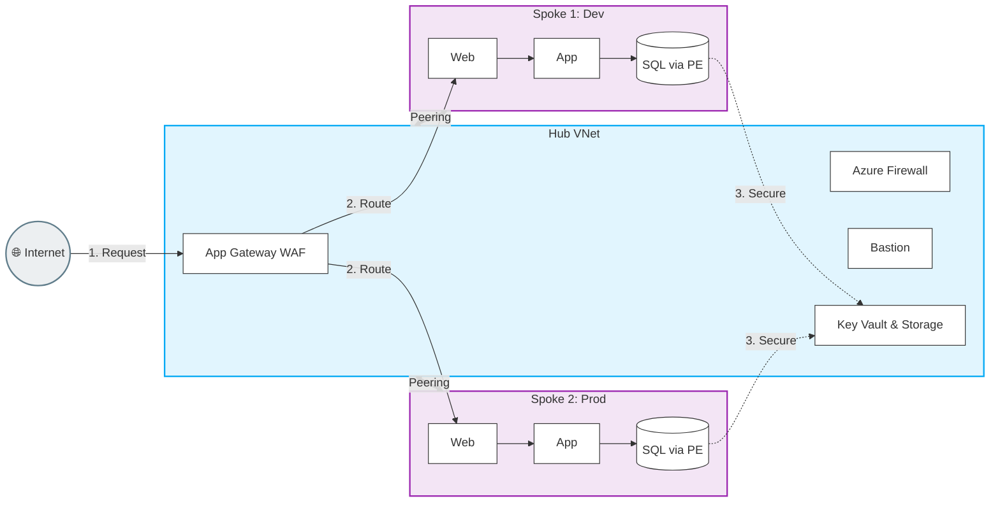

# 🕸️ Hub and Spoke Network Architecture — Complete Guide in Simple Language

---

## 🤔 What is Hub and Spoke?

Think of how an airport works. There's one **major hub airport** (like Heathrow or JFK). All airlines route their flights through it. Small regional airports (the "spokes") connect to the hub, but they don't have direct connections to each other.

If you're flying from Bristol to Edinburgh, you don't fly directly — you go Bristol → London Heathrow (Hub) → Edinburgh.

**Azure Hub and Spoke networking is exactly this model:**
- **Hub VNet:** The central, shared network. Contains shared security services (Firewall, VPN, Bastion).
- **Spoke VNets:** Individual application networks that connect to the Hub. Applications live here.
- Traffic between Spokes must travel **through the Hub** (for security inspection).

```
                    ┌─────────────────────┐
                    │      HUB VNet       │
                    │  ┌───────────────┐  │
         On-Premises│  │Azure Firewall │  │Internet
         ──────────►│  │VPN/ExpressRt  │◄─────────
                    │  │Bastion Host   │  │
                    │  └───────────────┘  │
                    └────────┬────────────┘
                             │ VNet Peering
              ┌──────────────┼──────────────┐
              │              │              │
     ┌────────▼───┐  ┌───────▼────┐  ┌─────▼──────┐
     │ Spoke VNet │  │ Spoke VNet │  │ Spoke VNet │
     │  (App A)   │  │  (App B)   │  │  (App C)   │
     │ Prod Sub   │  │ Dev Sub    │  │ Data Sub   │
     └────────────┘  └────────────┘  └────────────┘
```

---

## ❓ Why Hub and Spoke? (The Problem It Solves)

Before Hub and Spoke, the old way was a **flat network** — one giant VNet with everything inside it.

**Problems with a flat network:**
- 😓 **No isolation:** If App A gets hacked, the attacker can reach App B directly
- 😓 **Subscription limits:** Azure limits how many resources per subscription. One subscription for everything = hit limits quickly
- 😓 **Expensive redundancy:** Every VNet needing a VPN gateway or Firewall = paying for 10 firewalls instead of 1
- 😓 **No central security control:** Each team manages their own security, inconsistently

**Hub and Spoke solves all of this:**
- ✅ **Isolation:** Each application lives in its own Spoke (blast radius contained)
- ✅ **Shared cost:** One Firewall, one VPN gateway — shared by all Spokes
- ✅ **Centralized security:** ALL traffic goes through the Hub Firewall for deep inspection
- ✅ **Scalability:** Adding a new team = just add a new Spoke (no changes to Hub)

---

## 🧱 What Lives in the Hub vs. Spokes?

### Hub VNet — The Shared Security Layer

The Hub is managed by the **central Cloud Platform team**. It contains expensive, shared resources:

| Resource | Purpose |
|----------|---------|
| **Azure Firewall** | Inspects ALL traffic in/out of the network and between spokes |
| **VPN Gateway** | Connects your on-premises office to Azure via VPN tunnel |
| **ExpressRoute Gateway** | Private, dedicated fiber connection to Azure (faster than VPN) |
| **Azure Bastion** | Secure RDP/SSH access to VMs without exposing them to the internet |
| **Private DNS Zones** | Centrally manage DNS resolution for all private services |
| **Azure Monitor / Log Analytics** | Central logging for all security events |

### Spoke VNets — The Application Layers

Spokes are managed by **individual application teams**. Each Spoke has:
- Application VMs, AKS clusters, App Services
- Databases and storage
- Their own subnets and NSGs (Network Security Groups)

**Common Spoke pattern:**
```
Spoke VNet (e.g., 10.1.0.0/16)
├── snet-web    (10.1.1.0/24)  → Web servers / App Gateway
├── snet-app    (10.1.2.0/24)  → Application servers / AKS nodes
├── snet-data   (10.1.3.0/24)  → Databases
└── snet-pe     (10.1.4.0/24)  → Private Endpoints for PaaS services
```

---

## 🔌 VNet Peering — How Hub and Spokes Connect

**VNet Peering** creates a direct, private connection between two VNets over the Microsoft backbone. Traffic NEVER leaves the Microsoft network — no internet involved.

> **Important:** Peering is **non-transitive**. This means: Hub ↔ SpokeA and Hub ↔ SpokeB, but SpokeA ❌ SpokeB directly. Traffic from A to B MUST go through the Hub.

```
SpokeA → Hub Firewall → SpokeB    ✅ (through Hub)
SpokeA → SpokeB directly          ❌ (peering is non-transitive)
```

**Terraform implementation:**

```hcl
# ─── Hub to Spoke Peering ────────────────────────────────────
resource "azurerm_virtual_network_peering" "hub_to_spoke" {
  name                      = "peer-hub-to-spoke-app"
  resource_group_name       = azurerm_resource_group.hub_rg.name
  virtual_network_name      = azurerm_virtual_network.hub.name
  remote_virtual_network_id = azurerm_virtual_network.spoke_app.id

  allow_virtual_network_access = true   # Spokes can reach Hub resources
  allow_forwarded_traffic      = true   # Allow traffic forwarded by Azure Firewall
  allow_gateway_transit        = true   # ← CRITICAL: Allow Spokes to USE Hub's VPN/ExpressRoute
}

# ─── Spoke to Hub Peering ────────────────────────────────────
resource "azurerm_virtual_network_peering" "spoke_to_hub" {
  name                      = "peer-spoke-app-to-hub"
  resource_group_name       = azurerm_resource_group.spoke_app_rg.name
  virtual_network_name      = azurerm_virtual_network.spoke_app.name
  remote_virtual_network_id = azurerm_virtual_network.hub.id

  allow_virtual_network_access = true
  use_remote_gateways          = true   # ← CRITICAL: Use Hub's VPN/ExpressRoute gateway
  # Note: use_remote_gateways requires allow_gateway_transit=true on the Hub side
}
```

> ⚠️ **Common mistake:** Forgetting `allow_gateway_transit = true` on the Hub peering means Spoke VMs cannot reach on-premises through the Hub's VPN. Everything looks connected, but on-premises connectivity silently breaks.

---

## 🛣️ User Defined Routes (UDRs) — Forcing Traffic Through the Firewall

By default, Azure routes traffic between peered VNets directly. But we want ALL traffic to go through the **Hub Firewall** for inspection.

**UDRs (Route Tables)** override Azure's default routing. You define: "For ALL destinations, the next hop is the Azure Firewall."

```hcl
# ─── Route Table for Spoke Subnets ───────────────────────────
resource "azurerm_route_table" "spoke_rt" {
  name                          = "rt-spoke-app"
  location                      = azurerm_resource_group.spoke_app_rg.location
  resource_group_name           = azurerm_resource_group.spoke_app_rg.name
  disable_bgp_route_propagation = true  # Don't learn routes from VPN (let Firewall handle it)
}

# Force ALL traffic to the Azure Firewall (this is the key!)
resource "azurerm_route" "default_to_firewall" {
  name                   = "route-all-to-firewall"
  resource_group_name    = azurerm_resource_group.spoke_app_rg.name
  route_table_name       = azurerm_route_table.spoke_rt.name
  address_prefix         = "0.0.0.0/0"            # "All destinations"
  next_hop_type          = "VirtualAppliance"      # "Send to a specific device"
  next_hop_in_ip_address = "10.0.1.4"             # Azure Firewall's private IP
}

# Apply the route table to each Spoke subnet
resource "azurerm_subnet_route_table_association" "spoke_web" {
  subnet_id      = azurerm_subnet.spoke_web.id
  route_table_id = azurerm_route_table.spoke_rt.id
}
```

---

## 🚦 Traffic Flow Examples

### Case 1: Spoke A VM → Internet
```
VM in SpokeA
  → UDR routes to Azure Firewall (Hub)
  → Azure Firewall inspects & applies rules
  → If allowed: Firewall SNATs to its Public IP → Internet
  → Response: Internet → Firewall Public IP → Firewall → VM
```

### Case 2: Spoke A VM → Spoke B VM
```
VM in SpokeA (10.1.1.10)
  → UDR in SpokeA routes ALL traffic to Azure Firewall
  → Azure Firewall inspects: "Is SpokeA allowed to talk to SpokeB?"
  → If allowed: Firewall forwards to SpokeB (10.2.1.10)
  → VM in SpokeB receives traffic
```

### Case 3: On-Premises Server → Spoke VM
```
On-premises server
  → VPN tunnel → VPN Gateway in Hub
  → Azure Firewall inspects traffic
  → Routes to target Spoke VM
```

---

## ⚖️ Hub and Spoke vs. Azure Virtual WAN (vWAN)

| Aspect | Traditional Hub & Spoke | Azure Virtual WAN |
|--------|------------------------|-------------------|
| **What it is** | You deploy and manage Hub VNets yourself | Microsoft manages the hub infrastructure |
| **Scale** | Up to ~500 spoke VNets per hub | Thousands of spokes, multiple hubs, global mesh |
| **Multi-region** | Complex — need separate Hub per region + global peerings | Built-in — any spoke in any region connects automatically |
| **Cost** | Lower at small scale | Higher base cost, but cheaper at massive scale |
| **Control** | Full control over routing, NVA placement | Less control, more abstraction |
| **Best for** | Single-region, < 50 spokes | Multi-region, > 50 spokes, global enterprise |

**Decision rule:** Start with Hub & Spoke. When you grow beyond one region or start managing UDRs and peerings at scale becomes painful, migrate to vWAN.

---

## ✅ Implementation Checklist

- [ ] Hub VNet deployed with non-overlapping address space (e.g., `10.0.0.0/16`)
- [ ] Azure Firewall deployed in a dedicated `/26` subnet (`AzureFirewallSubnet`)
- [ ] VPN or ExpressRoute Gateway deployed in a dedicated `/27` subnet (`GatewaySubnet`)
- [ ] Azure Bastion deployed in a dedicated `/26` subnet (`AzureBastionSubnet`)
- [ ] Each Spoke VNet peered to Hub with `allow_gateway_transit = true` (Hub) and `use_remote_gateways = true` (Spoke)
- [ ] Route Tables applied to ALL Spoke subnets pointing default route to Firewall
- [ ] Azure Firewall Network Rules configured (allow only what's needed)
- [ ] Private DNS Zones linked to Hub VNet (and linked to Spokes via VNet Links)
- [ ] NSGs applied to all Spoke subnets as a secondary security layer
- [ ] Azure Firewall diagnostic settings sending logs to Log Analytics

---

## 🏗️ Architecture Deep-Dive: Secure Multi-Environment Hub & Spoke (Dev/Prod)

This section explains a production-ready, secure, scalable, and modular Hub-Spoke architecture managed via Terraform, specifically isolating Dev and Prod environments.

### 🌟 Why This Setup?
- **Secure and Isolated Network Design:** Strict network boundaries between Dev and Prod.
- **Separation of Environments:** Dedicated Spoke VNets for Dev and Prod prevent cross-environment contamination.
- **Scalable and Modular:** Terraform module structure allows easy addition of new spokes.
- **Centralized Security:** Hub VNet handles all security (WAF, Firewall, Bastion).
- **Private Access to Azure Services:** Uses Private Endpoints to access Key Vault, Storage, and SQL databases without public IPs.
- **Full Monitoring and Logging:** Centralized via Azure Monitor and Log Analytics.

### 🗺️ Architecture Diagram


### 🏗️ Network Topology Overview

#### 1. Hub VNet (`vnet-hub`)
The Hub acts as the central security and management boundary. It contains:
- **Azure Firewall Subnet (`10.0.0.0/26`):** Advanced threat protection and traffic steering between Spokes and Internet.
- **Application Gateway Subnet (`10.0.1.0/27`):** Houses the App Gateway with Web Application Firewall (WAF) for inbound internet traffic load balancing and security.
- **Bastion Subnet (`10.0.2.0/27`):** Secure RDP/SSH access to VMs without exposing public IPs.
- **Gateway Subnet (`10.0.3.0/27`):** VPN Gateway (Site-to-Site / P2S) for on-premise connectivity.
- **Management Subnet (`10.0.4.0/24`):** Central management tools.
- **Shared Services:** Key Vault (Secrets), Storage Account (Terraform remote state/logs), Container Registry, Private DNS Zones, and Log Analytics.

#### 2. Spoke 1: Dev (`vnet-dev`) & Spoke 2: Prod (`vnet-prod`)
Both Spokes follow identical subnet structures but use non-overlapping CIDR blocks (`10.1.x.x` for Dev, `10.2.x.x` for Prod).
- **Web Subnet (`10.x.1.0/24`):** Hosts Frontend Web VMs (e.g., NGINX). Receives traffic *only* from the Hub's App Gateway.
- **App Subnet (`10.x.2.0/24`):** Hosts Application Tier VMs. Runs business logic.
- **DB Subnet (`10.x.3.0/24`):** Hosts Azure SQL databases (via Private Endpoints). No public access.
- **Management Subnet (`10.x.4.0/24`):** Local Spoke management/jumpboxes (if not relying solely on Hub Bastion).
- **Private Endpoint Subnet (`10.x.5.0/24`):** Dedicated subnet for connecting to Azure PaaS services (Key Vault, Storage, SQL) privately.

### 🔄 Traffic Flow Summary
1. **User Request:** A user accesses the application via the Internet.
2. **WAF Inspection:** Traffic hits the Azure Application Gateway (WAF) in the Hub.
3. **Routing to Spoke:** WAF inspects and forwards clean traffic to the appropriate Spoke's Web Subnet.
4. **Internal Processing:** Web VMs talk to App VMs, which process business logic.
5. **Private Data Access:** App VMs query Azure SQL, Key Vault, and Storage via Private Endpoints on the Microsoft backbone. No traffic touches the public internet.

### 📦 Terraform Modules Structure
To achieve a **Modular Multi-Environment** setup, Terraform code is organized into reusable modules:
```text
modules/
├── network/
│   ├── vnet
│   ├── subnet
│   ├── vnet_peering
│   ├── nsg
│   └── route_table
├── security/
│   ├── firewall
│   ├── application_gateway
│   └── key_vault
├── compute/
│   ├── vm
│   └── bastion
├── database/
│   └── sql
└── monitoring/
    ├── log_analytics
    └── diagnostic_settings
```
*This structure allows you to instantiate `module "spoke_dev"` and `module "spoke_prod"` using the exact same underlying logic, ensuring consistency across environments.*
